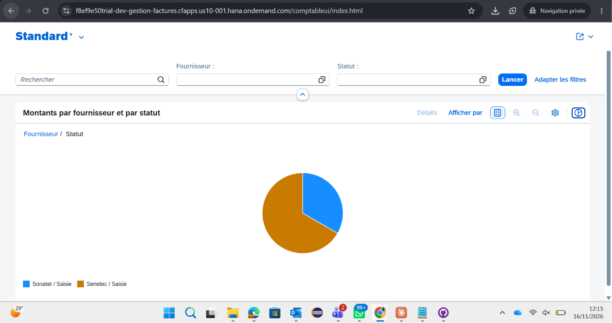
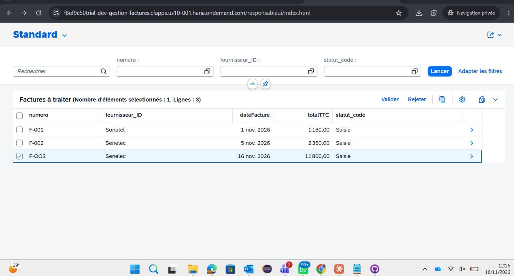

# Gestion des factures fournisseurs et des ordres de paiement

Application **SAP CAP (Node.js)** déployée sur **SAP BTP (Cloud Foundry)**. Une entreprise reçoit des factures de ses fournisseurs : un **comptable** les saisit, un **responsable** les valide ou les rejette, puis les factures validées d'un même fournisseur sont regroupées dans un **ordre de paiement**. L'application suit chaque facture de la saisie jusqu'au paiement.

## Ce que comporte le projet

| Couche | Contenu |
|---|---|
| **Modèle de données** | Fournisseurs, Factures, Lignes de facture, Ordres de paiement, listes de codes (statuts, devises) |
| **Services** | ComptableService, ResponsableService, AnalyseService |
| **Logique métier** | Handlers Node.js : total TTC automatique, contrôles, actions |
| **Interfaces** | 3 applications SAP Fiori Elements (saisie, validation, analyse) |
| **Sécurité** | Authentification XSUAA, deux rôles (`comptable`, `responsable`) |
| **Tests** | 8 tests automatiques avec `cds.test` |
| **Déploiement** | Fichier MTA : SAP HANA Cloud, XSUAA, approuter, HTML5 repository |

## Modèle de données (`db/schema.cds`)

- **Fournisseurs** : nom, e-mail, IBAN.
- **Factures** : numéro, date, fournisseur, devise, statut, totaux HT et TTC, motif de rejet, lignes (composition), ordre de paiement.
- **LignesFacture** : désignation, quantité, prix unitaire, TVA (18 % par défaut). Elles sont liées à la facture par une **composition**.
- **OrdresPaiement** : fournisseur, statut, total, factures regroupées.
- **StatutFacture** (`SAISIE`, `VALIDEE`, `REJETEE`, `PAYEE`) et **StatutOrdre** (`CREE`, `PAYE`) : listes de codes.
- Aspects utilisés : `cuid` (clé UUID) et `managed` (créé par, modifié par, dates).

## Services et rôles

| Service | Chemin | Rôle requis | Usage |
|---|---|---|---|
| ComptableService | `/comptable` | `comptable` | Saisie des fournisseurs, factures et lignes, avec mode brouillon (draft) |
| ResponsableService | `/responsable` | `responsable` | Lecture des factures, actions `valider` et `rejeter`, ordres de paiement |
| AnalyseService | `/analyse` | `comptable` ou `responsable` | Montants agrégés par fournisseur et par statut |

Le comptable ne peut pas valider, et le responsable ne peut pas saisir (`@requires` et `@restrict` dans `srv/security.cds`).

## Règles métier (handlers Node.js)

- Une facture **sans ligne est refusée**.
- Le **total HT et le total TTC sont calculés automatiquement** à partir des lignes.
- Une facture **déjà payée ne peut plus être modifiée ni supprimée**.
- **`valider`** : seulement pour une facture au statut `SAISIE`.
- **`rejeter(motif)`** : le motif est obligatoire, et seule une facture `SAISIE` peut être rejetée.
- **`genererOrdrePaiement(fournisseur, factures)`** : les factures doivent être validées, appartenir au même fournisseur et ne pas figurer déjà dans un ordre. L'action est disponible dans le service OData ; elle n'a pas encore de bouton dans l'interface.

## Interfaces SAP Fiori Elements (`app/`)

| Application | Dossier | Contenu |
|---|---|---|
| Analyse | `comptable-ui` | Graphique en colonnes empilées et tableau des montants par fournisseur et par statut |
| Saisie des factures | `factures-ui` | List Report et Object Page, brouillon, aides à la saisie (fournisseur, devise), table des lignes |
| Validation | `responsable-ui` | Boutons Valider et Rejeter, avec fenêtre de saisie du motif |

Les interfaces sont décrites par des annotations (`app/annotations-*.cds`).

## Captures d'écran

### Analyse des montants par fournisseur et par statut


### Saisie des factures (comptable)


## Structure du projet

```
db/        modèle de données et données de test (CSV)
srv/       services, handlers, sécurité
app/       applications Fiori Elements et annotations
test/      tests automatiques
docs/      captures d'écran
mta.yaml   description du déploiement SAP BTP
xs-security.json   rôles XSUAA
```

## Lancer en local

```bash
npm install
cds watch
```

Utilisateurs de test (authentification simulée, définie dans `.cdsrc.json`) : `comptable` / `comptable` et `responsable` / `responsable`. Utilise une fenêtre de navigation privée par utilisateur.

## Tests

```bash
npm test
```

Les 8 tests vérifient l'accès anonyme refusé, les droits de chaque rôle, le rejet sans motif, la double validation refusée et le regroupement de fournisseurs différents refusé.

## Déploiement sur SAP BTP

Prérequis : un subaccount avec l'environnement Cloud Foundry, une instance **SAP HANA Cloud** mappée à l'espace, et le plugin `multiapps` de `cf`.

```bash
cf login --sso -a <API-endpoint>
mbt build -t gen --mtar mta.mtar
cf deploy gen/mta.mtar
```

Après le déploiement, ajoute les utilisateurs aux collections de rôles `comptable` et `responsable` de l'application (cockpit BTP, Sécurité, Collections de rôles).

Remarque : en offre gratuite, l'instance HANA Cloud s'arrête chaque soir. Il faut la redémarrer, puis lancer `cf restart gestion-factures-srv`.

## Pistes d'évolution

- Récupérer les fournisseurs depuis l'API **Business Partner de SAP S/4HANA** au lieu de les stocker.
- Ajouter un bouton « Générer l'ordre de paiement » dans l'interface du responsable.

## Auteur

Momar Bosse Ndoye